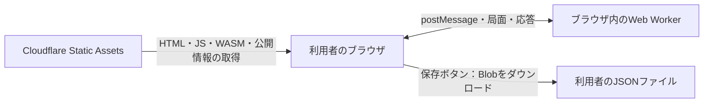

# 対局データはCloudflareへ保存されるか

2026-11-12調査。**この日時に調べたサービスは、遊ばれた棋譜をCloudflareへ自動送信・保存しない。**
2026-11-14のL4では[同意制の保存実装](GAME_DATA_COLLECTION.md)を追加した。以下のソース・bindingの記述は旧source `f3d2d66`の履歴であり、新しい受信Workerの実装状況ではない。[公開版への反映状況](PUBLIC_LAUNCH_PROGRESS.md)を別に確認する。
対局中の盤面・履歴はブラウザのメモリ内で保持し、「保存」は端末へのJSONダウンロードである。
アクセス数・HTTPログと、再生可能な棋譜の保存を区別する。

## ソースで確認したデータの流れ

図のWeb Workerはブラウザ内の探索／推論用で、Cloudflare Workerの受信APIではない。
Cloudflareへの棋譜送信、サーバー保存、保存済み対局の取得・共有URL発行の経路は実装されていない。

| 確認対象 | 実装・結果 |
|---|---|
| [App.tsx:125–133](../apps/web/src/App.tsx) | Blob→object URL→download属性でJSONを書き出す。サーバーへのPOSTなし |
| App.tsx:134–148 | 「棋譜＋AI条件」は局面／条件を固定し、`/build-info.json`をGETしてcommitを付けて端末へ保存。棋譜本文は送らない |
| [store.ts:137–158](../apps/web/src/game/store.ts) | Rust/WASM Gameのメモリ内履歴をexport/importする。永続ストレージやサーバー送信なし |
| [探索client](../apps/web/src/ai/search-client.ts)・[推論client](../apps/web/src/inference/policy-client.ts) | 局面をブラウザのWorkerへpostMessageする。HTTPでCloudflareへ送る処理ではない |
| [ModelLibraryPanel](../apps/web/src/inference/ModelLibraryPanel.tsx)・[local-model](../apps/web/src/inference/local-model.ts) | 公開catalogを取得し、利用者が選んだモデルファイルを端末内で読む。棋譜アップロード機能ではない |
| [wrangler.jsonc](../apps/web/wrangler.jsonc) | distのStatic Assetsのみ。受信Workerのmain、D1・KV・R2・Durable Objectsのbindingなし |
| フロント全体の検索 | 棋譜送信用のmethod/body、sendBeacon、WebSocket、XMLHttpRequest、操作収集SDK、localStorage／sessionStorage／IndexedDBの保存経路は見つからなかった |

通常の「保存」は手動操作であり、ページを閉じる／再読み込みする前に保存しないと対局を復元する経路はない。
HTTPキャッシュにJSやWASMが残ることを、対局の自動保存とは扱わない。

## 現行Cloudflareデプロイで確認したこと

2026-11-12 **22:27 JST**に、既存のプロジェクト専用認証を使い、`scripts/cf.sh deployments list --json`と
`scripts/cf.sh versions view <version-id> --json`を読み取り実行した。設定変更・アップロードは0。

| 項目 | 観測結果 |
|---|---|
| 対象 | Worker名`voxelshogi`、既存プロジェクトの公開URL |
| 現行deployment | `81b9cb89-a25a-4014-856d-3dfe828eb1df` |
| 100%配信version | `95140814-f739-4ccd-a82a-9625c39fd1af` |
| 作成日時 | 2026-11-05 09:02:43 UTC |
| version annotation | `commit:f3d2d66d73ee0c2085445a68c618a214897c0af1` |
| `resources.bindings` | **空配列、0件** |
| レビューしたmain | `d9ff82626c90cafa91895b9386aca7c87368dc7e` |

現行versionにD1／KV／R2等の保存bindingがないことを確認した。
棋譜export/importを持つApp、store、wrangler設定は公開版のGit sourceとレビュー対象で一致する。
mainにはM読込関連の差分があるが、棋譜送信機能の追加ではない。
アカウント内の無関係なDB／bucketの全一覧・既存行・全アクセスログを読み取った調査ではない。

Static Assetsのみでの配信と、mainとbindingを追加するアプリの違いは[Cloudflare公式](https://developers.cloudflare.com/workers/best-practices/workers-best-practices/)でも説明されている。
APIの小さい読取結果はGit管理外の`runs/public-launch-review/cloudflare-deployment.json`へ保持した。
認証情報・アカウントメール・キー・第三者のアクセスログは報告書へ転載していない。

## Cloudflareのアクセス記録との区別

Cloudflare側にリクエストの集計やログが存在する可能性はある。
今回はWeb Analyticsの自動挿入、Logpush、全ログ保存設定の有無までは確認していないため、
「アクセス情報も一切保存されない」「匿名である」「IP等が取得されない」とは説明しない。

一方で、ブラウザから送らない棋譜本文・着手列・勝敗・対局条件が、配信ログだけで再生可能な棋譜として蓄積されるわけではない。
`/build-info.json`やcatalogの取得は操作の推測材料になり得るが、対局そのものの保存とは異なる。
[Workers Logsの公式仕様](https://developers.cloudflare.com/workers/observability/logs/workers-logs/)も、invocation・custom log・error等の観測を扱うものである。

## 対局収集を追加する場合に必要なこと

今回は調査のみで、収集は開始していない。実装するときは、次を決めてから別の変更として行う。

1. **何を保存するか**：終局／中断の棋譜、ruleset、AI方式・モデル／精度形式、アプリcommit、結果・打切り理由。
   人間対AIとAI観戦を区別し、未完了・ランダム着手を強い教師と扱わない。
2. **何のために使うか**：不具合解析・利用傾向・研究／学習を分け、取得内容・保持期間・収集の選択をUIに説明する。
   HFへの公開やモデル学習への二次利用を、単なる対局保存と同じ扱いにしない。
3. **保存経路**：Cloudflare Workerの受信APIと、D1／R2等の保存先を追加する。無料範囲・上限・削除方法を確認し、
   端末の棋譜ダウンロードとサーバーへの送信を別の操作／表示として設計する。
4. **受信検証と運用**：サイズ・手数・schema・ruleset・全手の合法性・重複送信・頻度を検証する。
   クライアント申告の勝敗・棋力・教師ラベルはそのまま信頼しない。通信失敗で対局を止めない。

保存APIなしの現在のAlphaを紹介することと、収集基盤を実装してから紹介することは別の選択である。
現時点の正確な説明は「対局は端末内で進行し、必要なら棋譜をダウンロードできる。サーバーへの棋譜自動保存はない」。

UI側の公開前優先事項は[レビュー](PUBLIC_LAUNCH_REVIEW.md)を参照する。
